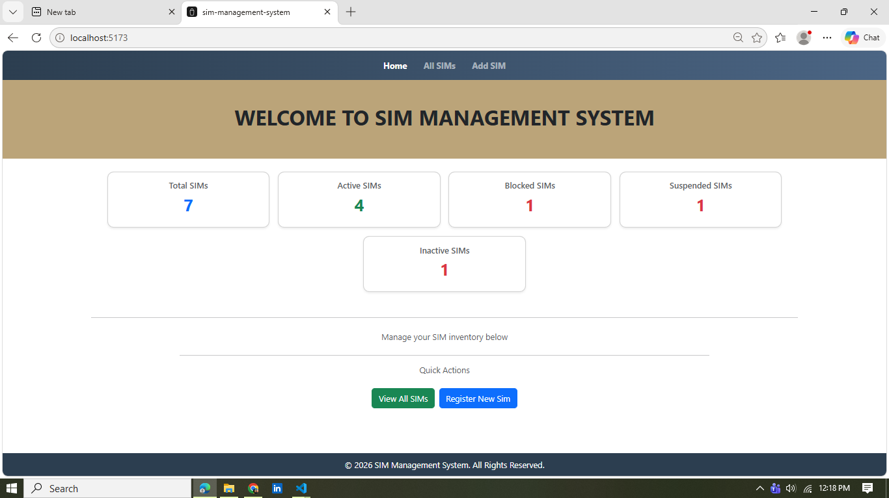
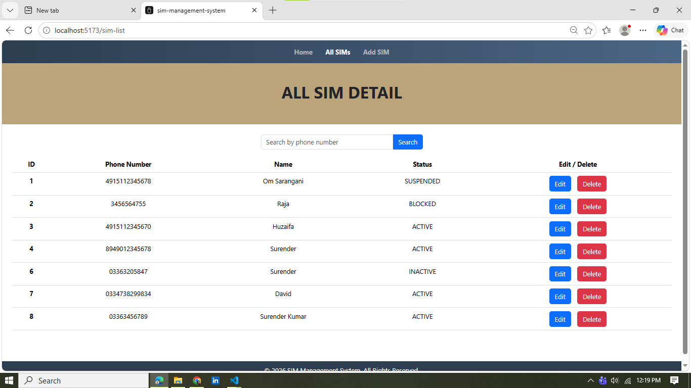
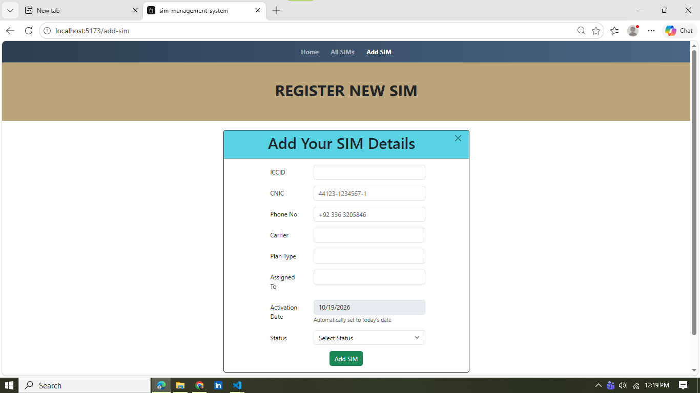

# SIM Management System — Frontend

A responsive web app to register, search, update and delete SIM cards. Built with **React + Vite** and **Reactstrap**, it talks to a **Spring Boot + MySQL** REST API.


## Screenshots

**Home** — summary cards and quick actions



**All SIMs** — table with search, edit and delete



**Register a new SIM** — form with validation; the activation date is set automatically and locked



**Edit a SIM** — the activation date cannot be changed after registration


---

## Features

- **Full CRUD** — add, view, edit and delete SIM cards
- **Search by phone number** — partial match (typing `0300` finds every number containing it); press Enter or click Search
- **Dashboard** — live counts of total, active, blocked, suspended and inactive SIMs on the home page
- **Delete confirmation** — a modal asks "Are you sure?" before anything is removed
- **Client-side form validation** with live, per-field error messages
- **Business-rule errors from the server** are shown as toast messages (duplicate ICCID or phone number, CNIC SIM limit)
- **Responsive layout** and loading indicators

### Validation rules

| Field | Rule |
|---|---|
| ICCID | Required, 19–22 digits |
| CNIC | Required, format `12345-1234567-1` (dashes are inserted automatically while typing) |
| Phone number | Required, 7–15 digits (any country code accepted) |
| Carrier | Required, max 60 characters |
| Plan type | Required, max 60 characters |
| Assigned to | Required, max 100 characters |
| Status | Required — Active, Inactive, Blocked or Suspended |
| Activation date | Set automatically to today on registration and **locked**; cannot be changed when editing |

### Business rules (enforced by the backend)

- ICCID and phone number must be **unique**
- A single CNIC can have at most **5 SIMs** registered

---

## Tech Stack

| Area | Technology |
|---|---|
| Framework | React (Vite) |
| UI | Reactstrap (Bootstrap 5) |
| Routing | react-router-dom |
| HTTP client | Axios |
| Notifications | react-hot-toast |

---

## Getting Started

### Prerequisites

- Node.js 18 or newer
- The backend API running locally (see [Backend](#backend))

### Installation

```bash
git clone https://github.com/Surender-Rathore/sim-management-system-frontend
cd SMS Frontend
npm install
```

### Environment variables

Copy the example file and set the backend URL:

```bash
cp .env.example .env
```

```env
VITE_API_BASE_URL=http://localhost:8080
```

### Run

```bash
npm run dev
```

The app opens at `http://localhost:5173`.

### Build for production

```bash
npm run build
```

---

## How This Project Was Set Up

Steps used to build the project from scratch:

1. **Create the Vite + React app**
   ```bash
   npm create vite@latest <project-name> -- --template react
   cd <project-name>
   npm install
   ```

2. **Routing** — React Router for page navigation
   ```bash
   npm install react-router-dom
   ```

3. **UI components** — Reactstrap (needs Bootstrap for its styles)
   ```bash
   npm install reactstrap bootstrap
   ```
   Then import the Bootstrap CSS once in `main.jsx`:
   ```js
   import "bootstrap/dist/css/bootstrap.min.css";
   ```

4. **Backend requests** — Axios
   ```bash
   npm install axios
   ```

5. **Notifications** — react-hot-toast
   ```bash
   npm install react-hot-toast
   ```

---

## Routes

| Path | Page |
|---|---|
| `/` | Home — summary cards |
| `/sim-list` | All SIMs — table with search, edit and delete |
| `/add-sim` | Register a new SIM |
| `/sim-edit/:id` | Edit an existing SIM |

---

## Project Structure

```
src/
├── api/
│   ├── axiosClient.js      # Axios instance (base URL, headers)
│   └── simCard.js          # All SIM API calls
├── components/
│   ├── NavBar.jsx
│   ├── SimTable.jsx        # Table, search bar, delete modal
│   └── LoadingBar.jsx
├── Jumbotron/
│   └── jumbotron.jsx
├── pages/
│   ├── Home.jsx
│   ├── AddSim.jsx
│   └── EditSim.jsx
├── utils/
│   └── Validatesim.js      # Shared validation + CNIC formatter
├── App.jsx
└── main.jsx
```

**Design notes**

- Validation lives in one shared function (`validateSimForm`) used by both the Add and Edit forms, so a rule is changed in a single place.
- All HTTP calls are kept in `api/simCard.js`; components never build URLs themselves.
- Business rules (uniqueness, 5-SIM limit) are enforced on the server, because client-side checks can always be bypassed. The frontend only displays the server's message.

---

## Backend

This frontend consumes a Spring Boot REST API.

- **Repository:** https://github.com/Surender-Rathore/sim-management-system-backend
- **Stack:** Java 21, Spring Boot 3, Spring Data JPA, MySQL

| Method | Endpoint | Purpose |
|---|---|---|
| GET | `/api/v1/sim-cards` | List all SIMs |
| GET | `/api/v1/sim-cards/{id}` | Get one SIM |
| GET | `/api/v1/sim-cards/search?msisdn=` | Search by phone number |
| POST | `/api/v1/sim-cards` | Create a SIM |
| PUT | `/api/v1/sim-cards/{id}` | Update a SIM |
| DELETE | `/api/v1/sim-cards/{id}` | Delete a SIM |

---

## Credits

- **Frontend:** Surender
- **Original backend:** Om Parkash Sarangani — built as a learning aid
- **Backend changes by me:** CNIC field (replaced IMSI), search by phone number, max 5 SIMs per CNIC, and error handling for the new rules

---

## Roadmap

- [ ] Enforce the 5-SIM CNIC limit on update as well as create
- [ ] Pagination for large lists
- [ ] Live search as the user types
- [ ] Deployment (Vercel for the frontend, Railway/Render for the backend)